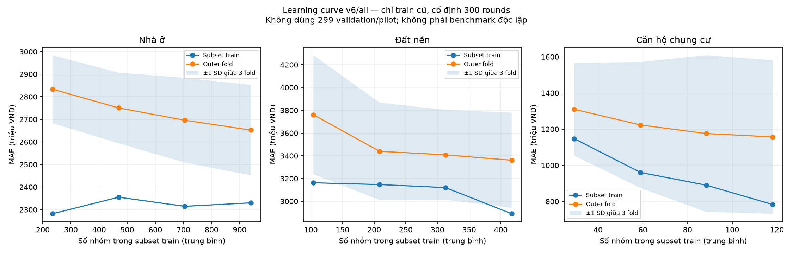

# Bổ sung dữ liệu và đường cong học — 29/10/2026

Theo [issue #14](https://github.com/manchae 19/SmartProp/issues/14). Nhánh
`feature/property-data-expansion`, kế tiếp PR#13. Đã thu nguồn, kiểm tra ngữ cảnh/
nhóm và đo learning curve. **API vẫn dùng v6**; chưa phát hành feature matrix
hoặc thay model ứng dụng.

## Nguồn đã thu

| Công việc | Thực thu | Trạng thái |
|---|---:|---|
| CafeLand train còn thiếu mô tả | 11/11 | HTTP 200 |
| Nhadat 24 h train còn thiếu mô tả | 143/143 | HTTP 200 |
| ID căn hộ CafeLand mới | 60/60 | HTTP 200, không trùng 8.731 ID trước |

Nhadat 24 h tạm dừng sau 49 snapshot vì URL có ký tự `²` chưa mã hóa cho HTTP.
Adapter chỉ percent-encode path, giữ host/ID/escapes/robots; đã tiếp tục từ
checkpoint đến 143, không tải lại 49 bản ghi. Plan/collector gốc giữ nguyên.

Lô 60 mới bắt đầu checkpoint 18, nằm trong giới hạn 16 trang và 20 tin/locality:
Ngũ Hành Sơn 20, Sơn Trà 16, Hải Châu 14, Hải Vân 6, Hòa Xuân 3, Liên Chiểu 1 theo
nhãn nguồn/catalog. Ba nhãn cuối là địa bàn mở rộng; không suy ranh giới cũ/mới
tương đương nhau. ID mới chưa đồng nghĩa tài sản mới hoặc mẫu đại diện.

Kết hợp 20 mô tả đã lấy ở đợt trước: **174 snapshot mới của ID train** và 60 ID
mới, tổng 234 snapshot có mô tả không rỗng, đều phân tích được. Ba căn hộ train
còn lại đã có mô tả cũ khớp. Như vậy đã lấy được mô tả cho các ID còn thiếu,
nhưng chất lượng mỗi tin vẫn phải qua cổng riêng.

Giá hiện tại và đặc trưng được đọc từ **cùng HTML/thời điểm quan sát**. Có 5 ID
train có giá hiện tại khác giá snapshot cũ. Các giá cũ không bị ghi đè. Snapshot
mới tạo phiên bản nghiên cứu hiện tại, không gán mô tả mới vào nhãn quá khứ.

## Qua lọc được bao nhiêu?

Run: `processed/property_expansion_review/runs/e58bb9db7377e200`, tính từ
`ai-services/app/data/`; pointer `processed/property_expansion_review/latest.json`.

| Nhóm | Ứng viên qua nguồn và nhóm | Cần review thêm |
|---|---:|---:|
|60 ID mới | **6 nhóm mới** |54 tin |
|174 ID train được đọc lại | **6 nhóm train hiện tại** |168 tin |

13 snapshot qua kiểm tra riêng về nguồn; sau đối chiếu nhóm còn 12 ứng viên.
Các quan hệ nhóm cũ và nhóm được bảo vệ được giữ trong graph overlay; không
đổi registry/split hoặc sử dụng 24 nhóm đã chấm để tối ưu/chấm model khác.
Tất cả vẫn `DO_NOT_TRAIN`, chưa tự tăng bộ train 2.213 dòng.

Các lý do thường gặp: không có đủ giá tổng/diện tích rõ trong lời rao, nhiều căn
hoặc giá khởi điểm, nhiều loại diện tích chưa giải thích, ngày nguồn cũ, phòng
ngủ/giá mâu thuẫn. **Cần review không có nghĩa tin đã được chứng minh sai.**
Không nới quy tắc chỉ để tăng số lượng qua cổng. Giấy tờ vẫn chỉ là lời khai,
giá là giá rao, chưa xác minh giao dịch hoặc tài sản độc lập.

Trong 234 snapshot có 27 lời rao rõ về tầng căn hộ,43 về nội thất,46 về giấy tờ;
năm bàn giao chưa có giá trị qua quy tắc. Trong 12 nhóm ứng viên qua cổng, các
số tương ứng là 4/5/4/0. Không tự gán dự án từ sidebar, ví dụ tìm kiếm hoặc
phần “tin cùng dự án” của website. Tên dự án/tòa còn cần review danh tính.

Tọa độ/POI đủ điều kiện vẫn 0: không tạo khoảng cách bằng tâm phường, pin chưa
xác minh hoặc tên đường gần nhất. Các lời rao độ rộng kiệt/ô tô vào đã rà trong
cohort trước vẫn là nguồn nghiên cứu cho nhà/đất, không phải đo đạc thực địa.

File chính: `current_snapshots_DO_NOT_TRAIN.csv`, `evidence_private_DO_NOT_TRAIN.csv`,
`decisions_private_DO_NOT_TRAIN.csv`, `group_links.json`, `summary.json`,
`manifest.json`. HTML/quote/ID và các file này giữ cục bộ, không đưa lên GitHub.

## Learning curve cho biết gì?

Chỉ dùng 2.213 train cũ, **không chấm 299 validation, pilot hoặc dữ liệu mới**.
36 model chẩn đoán dùng đặc trưng v6/all,3 fold theo nhóm,300 rounds cố định,
train subset lồng nhau 25/50/75/100%, vocabulary chỉ fit trên subsettrain.
Không early stopping hoặc chọn params theo điểmfold. Đây là các model tái
huấn luyện để chẩn đoán, không phải điểm số của model release v6.



MAE outerfold, triệuVND; mỗi mức ghép các dự đoán outerfold của cùng loại:

| Loại |25% subset |75% subset |100% subset | Giảm MAE 75%→100% |
|---|---:|---:|---:|---:|
| Nhà ở |2.833,60 |2.695,89 |2.652,34 |1,62% |
| Đất nền |3.760,99 |3.408,56 |3.361,04 |1,39% |
| Căn hộ |1.309,80 |1.175,69 |1.156,83 |1,60% |

100% là toàn bộ **phần train của mỗi fold**, trung bình 940 nhà,417,33 đất,
118 căn hộ, không phải model đã fit toàn bộ 1.410/626/177 mẫu. Dải nền biểu đồ
là±1 độ lệch chuẩn MAE outerfold giữa 3 fold, **không phải khoảng tin cậy**.
Ở mức cuối, độ lệch giữa fold khoảng 200/418/425 triệu cho nhà/đất/căn hộ.
Một số fold không cải thiện ở bước cuối; không suy tăng mẫu luôn giảm sai số.

Trong thí nghiệm này, tăng dữ liệu có ích nhưng lợi ích ở mức cuối nhỏ hơn
mức đầu. Chưa có căn cứ để cào hàng nghìn tin cùng kiểu rồi kỳ vọng chất lượng
tăng mạnh. Ưu tiên làm rõ đơn vị tài sản, giá tổng, diện tích và đặc trưng còn
thiếu; lấy mẫu đúng phân khúc/địa bàn và review các nguồn chưa rõ. Đây là kết
luận giới hạn trong train cũ, không phải đảm bảo cho nguồn mới hoặc thị trường.

Run curve: `processed/training_learning_curve/runs/5818e9bde128cf98`. Đã tải lại
36 model, replay **19.912 dự đoán**, tính lại 36 bộ metric fold và 12 điểm tổng
hợp. Không fit lại khi verify. Model/API, cohort, ledger và database giữ nguyên.

## Chạy và kiểm chứng

Tại gốc repo, venv hiện có đã bổ sung Matplotlib 3.11.2, giữ NumPy 2.5.3 và
XGBoost 3.4.1. Máy mới dùng `requirements_learning_curve.txt`.

```powershell
# Các lô đã xong: kiểm tra chỉ đọc, không tải lại
.\ai-services\.venv\Scripts\python.exe -X utf8 ai-services/app/data/collect_property_expansion.py refresh --source cafeland
.\ai-services\.venv\Scripts\python.exe -X utf8 ai-services/app/data/resume_nhadat_property_expansion.py
.\ai-services\.venv\Scripts\python.exe -X utf8 ai-services/app/data/collect_property_expansion_v2.py

# Replay giá/đặc trưng/nhóm từ snapshot, không gọi mạng
.\ai-services\.venv\Scripts\python.exe -X utf8 ai-services/app/data/verify_property_expansion.py

# Replay model, dự đoán và mọi metric đường cong học, không fit
.\ai-services\.venv\Scripts\python.exe -X utf8 ai-services/app/data/verify_training_learning_curve.py
```

Collector v1 là nguồn lưu trữ đã dùng; vận hành lô mới qua v2 có guard checkpoint.
V2 ở đây giữ cùng plan; muốn mở lô khác phải chốt baseline ID/quota/policy mới,
không xóa checkpoint hoặc thay target để kéo tiếp. Không gọi trực tiếp nhánh
`new` của collector v1 cho batch chưa hoàn tất. Chạy lại các lô hiện tại đã xác
nhận chỉ đọc. Không đăng ký tác vụ cào định kỳ hoặc vượt giới hạn nguồn.

Các mô tả này không tăng độ dài chuỗi thời gian: vẫn chưa có lịch sử đủ để
dự báo xu hướng. Kho theo dõi giá riêng vẫn ở phiên bản trước; snapshot đợt
này giữ trong `data_raw/property_expansion_20261029`, chưa nhập chung SQLite.

## Review

### Standards

Không có vi phạm tiêu chuẩn repo. Một heuristic P3 về chuỗi module nội bộ
(`audit.parser.audit`, `grouping.previous.old`) được ghi nhận; không refactor
các helper lịch sử đã khóa chỉ để xử lý heuristic. Phiên bản v2 dùng lại HTTP/
publish helpers và giữ v1 để tái tạo provenance.

### Spec

Một lỗi P2 đã tái hiện: checkpoint có thể tiến trong lúc đợi lock mà records
không đổi, khiến collector v1 ghi lùi checkpoint. V2 chụp/recheck bytes plan,
checkpoint và records sau khóa, dừng/nhả khóa trước mạng hoặc metadata khi có
race. Hai regression và hai reviewer đã xác nhận sửa đúng ở entry point v2.

Replay cuối phát hiện thêm lỗi so đồ thị theo thứ tự: thứ tự duyệt shingle có
thể thay đổi giữa tiến trình. Bộ giá trị/nhóm/quote và 830 liên kết vẫn khớp.
Verifier vận hành mới chuẩn hóa chiều/thứ tự của graph vô hướng, giữ mọi
liên kết, quy tắc, score, trường bổ sung và số lần lặp. Nó vẫn kiểm SHA,
fingerprint và dựng lại toàn bộ CSV/summary; không sửa run gốc hoặc nới so sánh
giá trị. Không dùng trực tiếp `--verify` của reporter v1 để kiểm lô này.

Tổng review: Standards 0 hard violation/1 heuristic P3; Spec 0 lỗi còn mở ở
entry point vận hành mới sau hai bản sửa. **105 unit test đạt**. Verifier đầy đủ cần kho nguồn
cục bộ; unit test dùng fixture, không cần dữ liệu cào hoặc gọi website.
